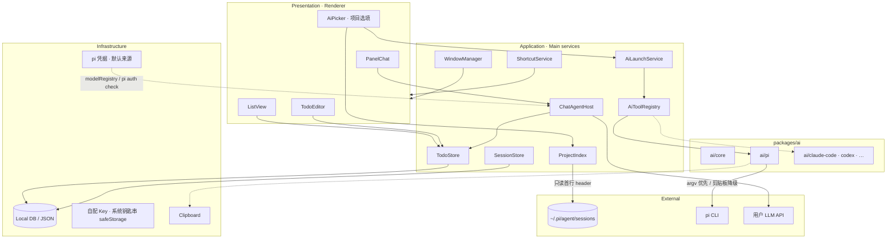
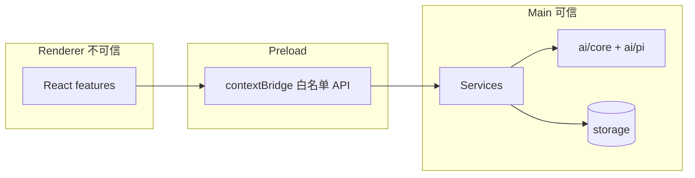
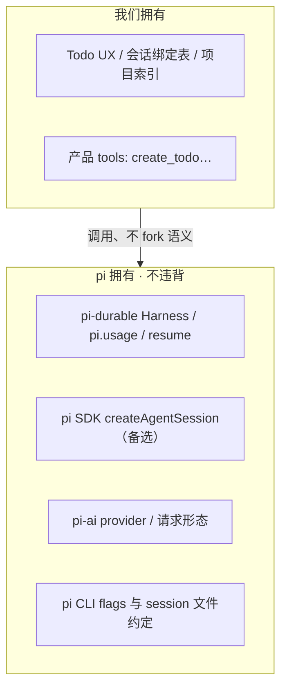
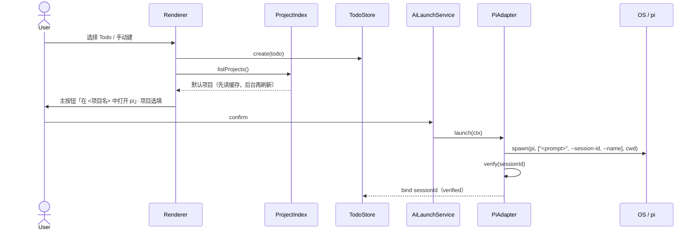
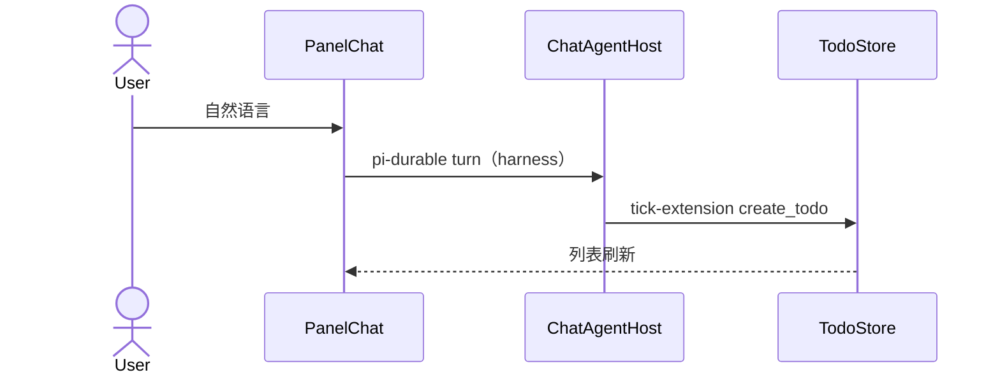

# 技术架构 · Tick 置顶 Todo 工作台

配合 `PRD-tick.md`（v0.3）与 `REVIEW-tick-v0.3.md`。会话执行层 = pi 1.2.0；上层产品自研；多 AI 经 `packages/ai/*` Adapter 扩展。

**v0.3 变更**：飞书相关能力整体移除；新增 `ProjectIndex`（从 pi 会话目录推导项目）；投递方式改为 argv 优先；数据根迁至 `~/.ticktodo`；Todo 与 session 改为 1:N；`create_todo` 以 pi extension 形式提供。

> 实测基线（pi 1.2.0）：`~/.pi/agent/sessions/<--cwd-encoded-->/<timestamp>_<uuid>.jsonl`，首行为 header
> `{type:"session",version:3,id,timestamp,cwd}`；`pi` 支持位置参数作为启动消息、`--session-id`、`--session-dir`、`--name`、`-e <extension>`；
> 扩展 API 有 `defineTool` / `createExtensionRuntime` / `ExtensionRunner`。库升级后需重核。

---

## 1. 架构原则

1. **产品在上，pi 在下**：Todo / 项目索引 / 拉起编排是我们的；执行与对话语义遵循 pi。
2. **双会话隔离**：面板会话（pi-durable，落 `~/.ticktodo/sessions/panel-chat/`）
   ≠ CLI `pi --session`；分 ID 存储。
3. **Adapter 扩展**：新 AI 工具 = `packages/ai/<name>`，不改主流程。
4. **可信边界**：API Key、spawn 只在 Electron Main；Key 不落数据目录。
5. **最小读取**：扫 pi 会话目录时只读首行 header，不碰对话正文。
6. **安装 ≠ 业务 CLI**：`scripts/install.sh` 只负责装 App。

---

## 2. 逻辑分层图



> 组合根在 app 层：`ai-host.ts` 实例化 `PiAdapter` 并注入 `ai/core` 的 registry；**`ai/core` 不依赖任何 `ai/<tool>`**（原图 `Core --> PiAd` 已按 as-built 移除）。

---

## 3. 进程与信任边界



---

## 4. 仓库目录（as-built）

```
tick/
├── apps/desktop/                # Electron 唯一应用
│   ├── src/main/                # window · ipc · services（todo / session / project-index 持久化）
│   ├── src/preload/             # contextBridge 白名单
│   └── src/renderer/features/   # list · editor · ai-picker · panel-chat
├── packages/
│   ├── shared/                  # 类型 + IPC 视图类型
│   ├── ai/
│   │   ├── core/                # Registry · 投递 · 会话命名空间 · **项目归并（工具无关）**
│   │   │   ├── canonical-path.ts    # 路径同一性
│   │   │   ├── project-merge.ts     # mergeProjects() 纯函数
│   │   │   └── session-ns.ts        # CliSessionId / PanelSessionKey
│   │   ├── pi/                  # PiAdapter：吐 ProjectSource，不做归并
│   │   └── <tool>/              # 第二个工具接入点（同合同，不碰 core 逻辑）
│   ├── tick-extension/          # pi extension：defineTool(create_todo / list_todos)
│   └── storage/                 # 可选（未落地）
├── scripts/install.sh           # 发布安装通道
└── docs/
```

依赖：`apps/desktop` → `shared` / `ai/core` / `ai/pi` / `tick-extension`；各 `ai/<tool>` → `shared`；禁止反向依赖 app。组合根在 app（`ai-host.ts`）；**`ai/core` 不得依赖具体 `ai/<tool>`**。

### 4.1 语言与运行时（选型依据）

全仓 **TypeScript 单语言**（main / preload / renderer / `packages/*` / tick-extension 均 TS；独立脚本用 `.mjs`）+ **Electron**：

- **决定性约束**：面板 Chat 的 `ChatAgentHost` 要**进程内**跑 `pi-durable`——它是 Node 包（D13，硬约束 Node ≥ 22.19.0）→ 运行时必须是 Node。Tauri/Rust 不能省掉 Node，只会变成 Rust + Node 两套运行时，不取。**Go / Wails 同理被否（2026-10-17 评审）**：Go 进程内嵌不了 npm 包，对话层还得开 Node sidecar + 跨进程序列化，两套运行时问题一模一样；Go 的强项（网关/并发服务）恰好是 Tick 明确不做的方向（见 magpie 调研 §8）。
- pi 本身就是 npm 包 + TS 生态（扩展 API `defineTool` 等都有类型导出）→ `PiAdapter` 与 `tick-extension` 可直接 import 官方类型，联动成本最低。
- 渲染层：Vite + `vite-plugin-electron`（已定）；UI 框架选 React/Vite 生态，无跨语言负担。
- **唯一要盯的坑**：Electron 主进程的 Node 版本跟 Electron 绑定。选 Electron 版本时核对**内置 Node ≥ 22.19.0**；所有候选版本都不满足时，把 `ChatAgentHost` 移到独立 Node 22+ 侧进程（main 经 IPC/stdio 通信，模块接口不变）——进 M2 技术验证清单。

---

## 5. 模块职责

| 模块 | 位置 | 职责 |
|------|------|------|
| WindowManager | main | 置顶、显隐（位置记忆待补） |
| ShortcutService | main | 全局快捷键（首版未实现） |
| TodoStore | main | CRUD、软完成；原子写 + 文件锁（`todo-store.ts`） |
| SessionStore | main | **只存绑定关系**（`Todo.bindings[]` 1:N + `primarySessionId`）；元数据不镜像，走 adapter |
| ProjectIndexService | main | **调度**各 adapter 采集 → 交给 core 归并 → 分段缓存（`cache/projects.json`）→ 失效重建 → IPC；含 **Warm/Ask 两级调度**（后台低优先级扫，用户请求时提速） |
| mergeProjects | ai/core | **工具无关**的纯函数：归一化 → git 根上卷 → 按路径合并证据 → 排序（可单测，不依赖任何 adapter） |
| canonicalPath | ai/core | 路径同一性：realpath / `/private/var` / 大小写 / trailing slash / worktree |
| CwdResolver | main | 默认 cwd 推导：绑定 session cwd（**按 `binding.toolId` 取对应 adapter**）→ `Todo.lastLaunch` → **home**；返回 `{cwd, source}`，UI 据此渲染按钮 |
| ChatAgentHost | main | **pi-durable** `Harness` + `openNodeSqliteStorage` 落 `sessions/panel-chat/`；加载 `tick-extension`；**不参与用量统计** |
| SessionUsage | ai/core | 类型 + 汇总（仅工具侧，同工具内求和）；取数由各 adapter 的 `computeUsage()` 负责 |
| AiToolRegistry | ai/core | detect、列出 adapters |
| AiLaunchService | main | 组装 LaunchContext → adapter |
| PiAdapter | ai/pi | 会话目录发现、argv/clipboard 投递、spawn、resume、`--name` |
| tick-extension | packages | `defineTool(create_todo / list_todos)`；CLI 与面板共用同一实现 |
| SessionIndex | ai/core | 已删除。会话索引由 Main 的 `SessionStore`（`cli-sessions.json`）单一持有 |

---

## 6. AiToolAdapter 合同

```ts
interface AiToolAdapter {
  id: string
  detect(): Promise<boolean>
  capabilities: {
    needsCwd: boolean
    resumeSession: boolean
    deliverPrompt: 'argv' | 'clipboard' | 'flag' | 'stdin' | 'none'
    // pi 的 argv = 立即发送（interactive-mode.js:894 session.prompt()），
    // pi 无"仅预填"模式 → 想要"等我回车"只能走 clipboard
    setSessionName: boolean        // pi: --name
    discoverProjects: boolean      // 能否从工具自身存储推导项目（cwd）
    describeSessions: boolean      // 能否回读 session 元数据
    usage: boolean                 // 会话是否自带 usage（pi ✅，见 §6.3）
  }
  discoverProjects?(): Promise<DiscoveredProject[]>   // pi: 扫会话目录（**先解析覆盖路径**，见 §6.2）
  listSessions?(cwd?: string): Promise<SessionRef[]>  // 工具侧权威列表（含未绑定的）
  describeSession?(id: CliSessionId): Promise<SessionInfo | undefined>
  // 跨工具接手（F6-a）：**有向、非对称**，不是"任意互转"
  // 实证：pi→pi 换目录 ✅（forkFrom(source, targetCwd)）；omp 读 pi 文件 ✅；pi 读 omp ❌
  // （SessionManager.forkFrom 要求源文件首行是 type:"session" 的 header，否则抛错）
  carry?: {
    acceptFrom: { format: string, via: 'fork' | 'import' | 'none' }[]  // 本工具能接手哪些格式
    exposes: { format: string }[]                                      // 本工具会话能被谁接手
  }
  // 用量（F6-b）：**只统计工具侧自己的会话**，面板 Chat 不参与
  // 各工具口径不同（pi 扫 jsonl 五类来源求和）→ 由 adapter 自己算，不做跨工具合并
  computeUsage?(sessionId: CliSessionId): Promise<SessionUsage | undefined>
  fork?(source: { toolId: string, sessionId: CliSessionId, filePath?: string },
        targetCwd: string): Promise<LaunchResult>
  // 降级：任何方向都可用"把摘要作为首条消息投递"保底（摘要优先取 compaction.summary）
  launch(ctx: LaunchContext): Promise<LaunchResult>
  resume(sessionId: CliSessionId, ctx: LaunchContext): Promise<LaunchResult>
  verify?(sessionId: CliSessionId): Promise<boolean>  // launch 后校验 session 真的产生
}

// session 元数据的权威源在工具侧；Tick 不镜像
SessionInfo {
  toolId, sessionId, cwd, name?, createdAt, lastUsedAt,
  exists: boolean
  resumable: boolean        // false = 只读会话（不能 resume）
  hasLocalFiles: boolean    // false = 机器上看不到它的文件（远端/网关侧），只能看不能跳
  parentSessionPath?: string  // 对齐 pi 官方 header 的 `parentSession`：
                              // **只在 /fork、/clone、newSession({parentSession}) 时出现，值是源会话文件路径**
                              // 读首行即可拿到（零成本）。用途：标注血缘 + 用量求和时跳过继承段
  usage?: SessionUsage       // 可选，见 §6.3（默认不计算）
}
```

**别把两件事混为一谈**：
- `parentSessionPath` = **fork 血缘**（同一工具内复制出来的新会话）；
- **子代理会话**是另一回事——pi 把子代理写成 `<session>/0-Explore.jsonl` 之类的**独立子文件**
  （magpie 实证），它不在 `parentSession` 字段里，需要靠文件路径/命名识别并过滤。

`name` 的 fallback 链（与 pi 一致）：
**用户/我们给的名字（`--name`）→ 工具自己的 title → 首条 prompt**。
第三档要过滤 `<…>` 上下文标签、`# AGENTS.md`、图片后再压成一行，否则标题是噪音。

**分工原则**：adapter 是 session 元数据的唯一权威源（`cwd` / `name` / 活跃时间 / 是否存在）。
Tick 侧只持久化 `Todo.bindings[]` + `primarySessionId`，其余字段运行时向 adapter 要、缓存可随时丢弃重建——
否则 session 在工具侧被改名/删除后，镜像立刻腐烂。

LaunchResult = { toolId, sessionId: CliSessionId, cwd, pid?, delivered: 'argv' | 'clipboard' | 'none' }
```

`pid` 缺席表示 spawn 失败，调用方据此报 `ok: false`。`CliSessionId` 是品牌类型，只能由 `parseCliSessionId` 或 `newCliSessionId` 产出。

pi：`deliverPrompt = argv`（`pi "<消息>"` 作为启动即发送的初始消息；不支持时降级 clipboard），`resume` → `pi --session <id>`，命名 → `pi --name <标题>`。

**session id 来源**：`launch` 预生成 UUIDv7（`newCliSessionId`）并传 `--session-id <id>`，由 pi 在启动时按该 id 创建 session（已验证 pi 1.2.0）。binding 不依赖事后读盘，但需要 `verify()` 兜底——spawn 成功不代表 pi 侧真的落了盘，失败标 `verified: false` 并在 UI 提示。

**项目发现（pi 实测结构）**：

```
~/.pi/agent/sessions/
├── --Users-jacky-Desktop-tick--/        # 目录名 = cwd 编码（有损，仅作候选）
│   └── 2026-10-15T16-43-43-863Z_<uuid>.jsonl
└── <uuid>.jsonl                          # 顶层散落：无项目归属，容错跳过
```

每个 jsonl **首行**为 header：`{type:"session", version:3, id, timestamp, cwd}`。

实现约束（源码核对，`core/session-manager.js`）：

- 目录名只作候选，**以 header 的 `cwd` 为准**（编码把 `/` `\` `:` 全换成 `-`，有损）
- **pi 不做 git 根归并**：一个 cwd 一个目录（`getDefaultSessionDirPath`，L290-294）
- ProjectIndex 只读首行，不读正文；解析失败即跳过
- **session 名不在 header**：`--name` 会追加一条 `{type:"session_info", name}`（L913-921），
  读取取最新一条（L515-517）→ 要拿 name 必须全量扫文件（pi 自己也如此）。
  adapter 全量扫时**只取 `name` / 首条 user 消息 / `messageCount` / `modified`，禁止缓存 `allMessagesText`**
- 陷阱：`getDefaultSessionDir()` 会 `mkdirSync` 创建缺失目录 → spawn 时 cwd 传错会凭空造出一个项目目录

**默认 cwd 推导（项目选填，`CwdResolver`）**：

```ts
resolveCwd(todo, ctx): { cwd: string, source: 'session' | 'lastLaunch' | 'home', degraded?: string }
// 1. todo.primarySessionId 存在 → adapter.describeSession(id).cwd   （工具侧权威值）
// 2. todo.lastLaunch.projectPath 存在且目录仍在 → 用它                （Tick 自持的 UI 记忆）
// 3. home（os.homedir()）                                          ← 兜底，不猜（D18）
// 设置项 defaultProject = 'recent' 时，第 3 步改为 ProjectIndex 最近使用且非 stale 的项
// 设置项 defaultProject = 'ask'   时，跳过 2/3，强制走选择器
```

> **第 3 步定为 home 而非"最近使用"**（PRD F4-a）：home 是**确定的兜底**，用户一眼知道"我没选"；
> "最近使用"是**猜测**，猜错时用户没有预期。想猜的人在设置里选"最近使用"。

- 纯函数、可单测；不写状态，只在用户**显式**选择时更新 `Todo.lastLaunch`
- 第 2 步命中 stale（目录已不存在）→ 降级到 home **并返回 `degraded` 原因**，UI 必须提示
- 返回值带 `source`：UI 据此决定按钮文案（`在 **主目录 ~** 中打开 pi`）与是否显示"可改"

**冷启动策略（Q8 定案，取自 magpie 实证 `RESEARCH-magpie.md` §7）**：

```text
启动 → 读 cache/projects.json → 首帧立即渲染（无缓存则首帧 = 主目录 ~）
     → 后台低优先级扫描（Warm：并发限 1/4 核）
     → 用户打开选择器（Ask）→ 立即提速到全速
     → 扫完 → 原子写回缓存 + IPC 推送刷新
```

四条硬约束：

1. **目录列表缓存带 racy 窗口**：mtime 粒度粗 + 目录 size 常不变 → 2 秒内新增的文件会被缓存藏起来
   （magpie `discovery.go` `racyDirectory = 2s`）。**`verify()` 必须绕过缓存直读**（与 PRD 验收 4.3 同源）。
2. **文件级增量按 `(size, mtime)` 判定**，消失的条目从缓存删除（magpie `sessions.go:757`）。
3. **checkpoint 落盘**：magpie `checkpointEvery = 5s`，防止长扫描中用户退出导致下次重扫（#1665）。
   我们规模小（103 会话 / 49 MB ≈ 1s），可简化为扫完即存，**但接口预留**。
4. **缓存版本戳**：`cacheVersion` 变化即整体作废重建（magpie 用版本号写进目录名）→ 我们已有 `piVersion` 戳。

---

### 6.1 跨工具项目索引的分层（多 AI 工具接入时）

**核心判断**：项目（"我在哪个目录干活"）是**工具无关**的概念；session 才是工具私有的。
所以**目录做主键，工具只做证据标签**。三层分工：

```
ai/<tool> adapter  →  ProjectSource（原始候选 + 证据，不做任何归并）
ai/core            →  mergeProjects() 纯函数：归一化 → 上卷 → 合并 → 排序
main               →  ProjectIndexService：调度 + 分段缓存 + 失效 + IPC
```

```ts
// adapter 输出：只贡献证据
ProjectSource {
  toolId: string
  projects: { path: string, sessionCount: number, lastUsedAt?: number, exists: boolean }[]
}

// core 归并后的唯一形态（主键 = canonical 路径）
ProjectEntry {
  path: string            // canonical；开启上卷时为 git 根
  children?: string[]     // 上卷前的真实 cwd，需要时可细选
  tools: string[]         // 多值：pi / claude / …（不是单值）
  sessionCount: number    // sum（跨工具累加）
  lastUsedAt?: number     // max（跨工具取最近）
  lastLaunchedAt?: number // Tick 拉起时自写（跨工具统一时钟，见下）
  pinned: boolean         // 用户手动添加 → 不参与 stale 清理
  exists: boolean
}

// 预留：别把"项目"写死成目录
ProjectRef = { kind: 'dir', path: string } | { kind: 'remote', toolId: string, ref: string }
```

**三条硬规则**：

1. **主键 = canonical path**，绝不写成 `(toolId, path)`。同一目录被两个工具用过，
   在用户心智里就是一个项目；拆成两条是纯噪音（这正是 pi 与第 2 个工具最容易撞的地方）。
2. **adapter 不做归并**。pi 是一个 cwd 一个目录，别的工具可能是完全不同的存储结构；
   归一化和上卷规则只有 core 能统一。adapter 只吐原始 cwd + 计数 + 时间戳。
3. **`source` 单值改 `tools[]` 多值**。现 `source: 'pi' | 'user'` 在第二个工具接入时语义就冲突了
   （到底是 pi 还是 user？）。改为 `tools: string[]` + `pinned`（用户添加的项目置顶且不被清理）。

**排序：Tick 自己的拉起历史是唯一跨工具统一的时钟。**

各工具的 `lastUsedAt` 口径不同（pi 用 jsonl 的 mtime，别的工具未必），而且会偏斜——
上周密集用 A 工具、近三天只用 B 工具，`max()` 也可能排错。
因此排序优先级：**`lastLaunchedAt`（Tick 拉起成功时回写）> `lastUsedAt`（adapter）> 目录 mtime**。
这也是 `AiLaunchService` 每次成功拉起都要回写一条 `lastLaunchedAt` 的理由——P0 就要写，
否则第二个工具接入时没有可对齐的时钟。

**路径同一性（`canonicalPath`，集中在 ai/core，所有 adapter 输出先过它）**：
realpath（symlink）、`/private/var` ↔ `/var`（macOS）、大小写不敏感 FS、trailing slash、
**git worktree（`.git` 是文件时不再向上归并）**。

**git 根上卷**：默认**开启**，解决"同仓库多子目录炸成多条"；但保留 `children[]`，
需要时可选回真实 cwd。monorepo 因此自动收敛成一条。

**多工具对 CwdResolver 的修正**：`Todo.bindings[]` 带 `toolId`，所以第 ① 步必须先
`registry.get(binding.toolId)` 拿到**对应** adapter 再 `describeSession(id)`——
不能直接拿 sessionId 去问 pi（单工具时期最容易留下的隐性假设）。

**`Todo.lastProjectPath` → `Todo.lastLaunch { toolId, projectPath }`**：
多工具下"上次用哪个工具 + 哪个目录"是一个整体记忆，拆成两个字段会在切工具时选错
（记住了目录、却用另一个工具打开）。

---

### 6.2 会话发现的三个陷阱（magpie 实证，先读 `RESEARCH-magpie.md`）

**陷阱 1 · 路径可被覆盖，硬扫 `~/.pi/agent/sessions/` 会漏**

pi 的目录不是固定的（magpie `sessions/pi.go`）：

| 来源 | 说明 |
|------|------|
| `$PI_CODING_AGENT_DIR` | agent 目录，缺省 `~/.pi/agent` |
| `$PI_CODING_AGENT_SESSION_DIR` | 会话目录，**优先级最高** |
| `settings.json` 的 `sessionDir` | 会话目录；此时是"所有 session 平铺在一个目录里"，没有项目子目录 |

→ adapter 必须按上表顺序解析，**两处都要扫**；且 `settings.json` 是 **jsonc**（带注释/尾逗号），不能 `JSON.parse`。

**陷阱 2 · 目录列表缓存有 racy 窗口，会直接咬 `verify()`**

目录 mtime 粒度粗（Linux 一个 tick，部分 FS 一秒），**同一 tick 内新增文件不改变目录 mtime**，缓存会把它藏起来
（magpie：`racyDirectory = 2 * time.Second`，且只缓存条目名、文件内容每次重新 stat）。

→ **`verify()`（launch 后确认 session 真的产生）必须绕过缓存直读**。
否则刚 spawn 出来的 session 会被判成"没产生"→ 误标 `unverified`——这正是我们想防的僵尸绑定的**反面**（假阴性）。
→ 缓存 key 用 `(path, size, mtime)`；对"刚刚写入过"的路径强制不走缓存。

**陷阱 3 · fork 出来的会话会复制条目，连时间戳一起（含 usage）**

magpie：`a session forked from another starts with a copy of that one's entries, times and all`。
pi 源码印证（`session-manager.js` L1407–1412）：`// Copy all non-header entries from source`。

- ~~反向建索引（S5）要按内容去重~~ → **产品已拍板不去重**：fork 出来就是两个会话，按真实展示。
- 但**用量求和**要处理：`SessionInfo.parentSessionPath` 存在时，本会话的前 N 条是继承来的
  （N = 源文件的条目数），求和时跳过。这只是记账口径，不是去重。

**顺带**：`resume` 命令由 adapter 用**数组参数**组装（magpie 拼的是 shell 字符串所以要先过 `safeID` 正则）；
我们用 spawn 数组不需要 shell 转义，但 **sessionId 的字符集校验仍要做**（它会出现在 argv 与文件名里）。

---

### 6.3 用量统计（可选特性，默认关）

**pi 会话自带 usage，不必做网关就有数据**（`RESEARCH-pi.md` §2）。开启后的实现口径：

```ts
SessionUsage {
  tokens: { input, output, cacheRead, cacheWrite, total }
  cost?:  { input, output, cacheRead, cacheWrite, total }   // 见下方"成本不可全信"
  byModel: { provider, model, tokens, cost }[]              // pi 的 message 层就带 provider/model
  messageCount: number
  computedAt: number
  costReported: boolean   // false = 至少有一个 provider 未上报成本 → UI 必须标注
}
```

**官方规定的五个来源，必须全算**（只算 assistant 会漏）：

| 来源 | 路径 |
|---|---|
| assistant 消息 | `entry.message.usage`（role=`assistant`，100% 覆盖） |
| toolResult 消息 | `entry.message.usage`（嵌套模型工作，官方："contributes to full-session statistics"） |
| `type:"usage"` | `entry.usage`（`kind` 任意，如 `cache_warm`；未知 kind 照常计入） |
| `type:"compaction"` | `entry.usage` |
| `type:"branch_summary"` | `entry.usage` |

**三条红线**：

1. `reasoning` 已含在 `output`，`cacheWrite1h` 是 `cacheWrite` 子集 → **都不重复加**；
2. `totalTokens` 中 **98.9% 是 cacheRead**（本机 15.09 亿 / 15.25 亿）→ 展示时要能解释缓存占比，
   别当成"烧掉的量"；钱看 `cost.total`；
3. **`cost` 不是每个 provider 都上报**（本机实测某 provider 470 万 token 报 $0）→
   `costReported: false` 时 UI 只能标"≥"或"部分 provider 未上报"，不能显示成实数。

**实现约束（不破坏"不读正文"原则）**：

- 用法：按需（打开详情时）+ 缓存 key `(path, mtime, size)`，**不常驻扫描**；
- 解析后只取 `usage` / `provider` / `model` / `role` / `timestamp`，**`content` 一律丢弃**——
  I/O 躲不掉（正文在同一行），但内存与隐私风险可控；
- `context_edit` 官方明确不改变 accounting → 不用特殊处理；
- `"pending"` 的 assistant 消息官方明确不落盘 → 不会遇到半条；
- **失败的尝试也要计入**（pi-durable README 原话："Failed and aborted attempts count too"）。

**参考实现已就绪**：`scripts/session-usage.mjs`（Node、零依赖）。
它按官方 `addUsage` 实现，本机 103 个有效会话跑通，**自洽校验 103/103**，
且与一份独立实现的 Python 统计**总量完全一致** → 口径可信，可直接移植为 `ai/pi` 的 `computeSessionUsage()`。

**只有一套来源：AI 工具自己的会话文件**（不设 `source: 'cli' | 'panel'` 的统一层）。

用量统计的对象是「工具侧每个会话」，所以它是 **adapter 的能力**，不是统一服务：

```ts
// adapter 合同（可选能力：不是每个工具都有 usage）
computeUsage?(sessionId: CliSessionId): Promise<SessionUsage | undefined>
```

- **面板 Chat 没有用量**——它是捕获/建 todo 的入口，不参与统计，
  也就不需要去读 durable 的 `pi.usage` document；
- 第二个工具接入时，它用自己的 `computeUsage()` 算自己的，**不合并成一个跨工具总账**
  （各工具 token 口径与 provider 单价不同，合并出的数字没有意义）；
- 汇总只在同一工具内做：单会话 → 同一 todo 下该工具的会话求和 → 同一项目下求和。

**空会话必须处理**：本机 `~/.pi/agent/sessions/` 顶层有 **31 个 0 字节 `.jsonl`**
（文件名是纯 UUID、无 `timestamp_` 前缀）——spawn 出来但一条没写。
→ `verify()` 除"绕过缓存直读"外**还要判 `size === 0`**（存在但为空 = 未真正产生）；
→ 会话列表/项目索引过滤掉，否则用户看到一串空条目。

---

## 7. 与 pi 的边界（必须遵守）



- **两条集成路径各司其职，别混**：
  - **CLI 拉起（主路径）**：spawn 交互式 TUI 到终端，只用官方 flags
    （`--session` / `--session-id` / `--name` / `--fork` / `-e`），cwd 由调用方传入
  - **面板 Chat（D13 定案）**：`Harness.open(await openNodeSqliteStorage("~/.ticktodo/sessions/panel-chat/…"))`
    走 **pi-durable**；用它的 `resume()`（崩溃续跑）与 `requestId` 幂等。
    它自带的 `pi.usage` document **不读**——面板不参与用量统计（§6.3）。
    **必须 pin 1.3.0**（README 首行即 "Experimental. The API changes without notice"），
    且 **Node ≥ 22.19.0**
  - 备选：**pi SDK**（进程内 `createAgentSession`）、**`RpcClient`**（长驻进程，未来自动化用）
- 不把面板 session id 当成 CLI session id
- **session 格式版本要容错**：官方 `version` 现为 3（v1 线性 / v2 树 / v3 `custom` 改名），
  pi 加载时自动迁移 → 我们读文件时不能假设恒为 3，未知字段必须忽略而非报错
- **开发前升级 pi 到 1.3.0**（本机 1.2.0），并在 `detect()` 里校验版本
- **凭据双来源（PRD F5 修订）**：默认来源 = pi 本体
  （`ExtensionContext.modelRegistry` 解析 key，就绪性走 `pi auth check`）；
  M3+ 自配来源 = 内置 pi-ai 直连上游（OpenAI 兼容 endpoint，各类网关/代理由此接入），
  Key 用 Electron `safeStorage` 存**系统钥匙串**，**永不进 `~/.ticktodo/data/`**。
  两者做成可插拔 `CredentialSource`，未来逐工具凭据共用此口子
- **`detect()` 失败（pi 未安装）= 引导空态双出口**（PRD Q14 修订）：面板 Chat 提示
  "去装 pi 或去自配 provider"；CLI 拉起与 ProjectIndex 不可用（依赖 pi 会话目录，与凭据无关），
  Todo 手动路径与导出照常
- `create_todo` 以 **pi extension**（`defineTool`）提供，CLI 与面板加载同一实现；写操作标为非 safe 重跑 + 幂等键
- 扩展安装走 pi 的**自动发现目录** `~/.pi/agent/extensions/`（默认启用，不必 `-e`，也不改用户 settings）；
  备选 `pi install <path>`（写 `settings.json` 的 `extensions`，同样默认启用）
- extension 直接读写 `~/.ticktodo/data/todos.json`，与 Main 侧共享原子写 + 文件锁；面板用 `fs.watch` 感知变更
- **导出（F8）**：只读 `data/` + 向 adapter 实时问 `describeSession()`，
  **不复制会话文件、不写正文**；产物落 `exports/`

---

## 8. 主路径时序

### 8.1 Todo → pi



### 8.2 面板对话建 Todo



---

## 9. 数据存储

数据根：`~/.ticktodo`（可用 `TICK_HOME` 覆盖；从 `userData` 迁入需版本化 + 迁移函数）。

```
~/.ticktodo/
├── README.md               # 自动生成：各层用途与同步建议
├── data/                   # ✅ 可同步 · 关键（几十 KB，丢了致命）
│   ├── todos.json               # 版本化 + 原子写 + 文件锁（CLI 与面板并发写）
│   ├── cli-sessions.json        # 仅绑定关系（bindings / primary）
│   └── settings.json
├── sessions/               # ⚠️ 不建议同步 · 含对话正文（MB 级，丢了可承受）
│   └── panel-chat/              # pi-durable store，与 CliSessionId 命名空间隔离
├── cache/                  # ❌ 无需同步 · 可再生
│   └── projects.json           # ProjectIndex 缓存（带 mtime / piVersion 戳）
└── exports/                # F8 手动导出产物
```

**Q6 定案：一个目录 + 分层**（不拆到 Application Support）。分层的作用是把
"可同步 / 不可同步 / 可再生"变成可执行的一句话。实现要点：
`TICK_HOME` 覆盖时整棵子树一起搬；缺失目录启动时按需创建；
**`cache/` 被删不应导致任何功能异常**（重扫即重建）。

- 面板会话落盘：**pi-durable@1.3.0**（D13 定案）的
  `openNodeSqliteStorage(path)`（或 `openNodeJsonlStorage(dir)`）指向 `sessions/panel-chat/`。
  本机尚未安装，M2 需装 `@earendil-works/pi-durable` + `@earendil-works/pi-ai` + `@earendil-works/chord`。
  备选：pi SDK 的 `createAgentSession({ sessionManager })`（自管 `SessionManager`）。

- **凭据双来源（PRD F5 / Q14 修订）**：默认复用 pi 的 provider 凭据——
  `ExtensionContext.modelRegistry` 做 key 解析，就绪性用 `pi auth check --provider <p> --json` 探测
  （实测本机默认 provider 返回 `invalid`，所以首屏必须先探测再决定引导）。
  M3+ 自配来源：内置 pi-ai 直连上游（OpenAI 兼容 endpoint，各类网关/代理由此接入），
  Key 用 `safeStorage` 存**系统钥匙串**。无论哪条路，`~/.ticktodo` 下都**不存在**凭据文件，
  也就没有"被 dotfiles 同步带走"的风险
- 面板会话与 Todo DB 分离，仅存引用
- 权限：启动时校验目录属主与可写性（root 跑过会留下 root 属主文件）

---

## 10. 安全

- Preload 白名单 IPC；Renderer 无 Node  
- 不把 token 打进日志  
- spawn 参数固定可枚举，避免 shell 拼接注入  
- 扫 pi 会话目录属"读别人的家目录"：只开只读、只取首行、失败即跳过，结果不进日志
- 数据目录 `~/.ticktodo` 设 `0700`，文件 `0600`

---

## 11. 发布

| 阶段 | 方式 |
|------|------|
| Dev | vite-plugin-electron / `pnpm --filter @tick/desktop dev` |
| Prod | 未落地。无 electron-builder 依赖与配置，`pnpm build` 只产出未打包的 main / preload / renderer |

---

## 12. 演进

| Phase | 内容 |
|-------|------|
| P0 | ai/pi only（本地 Todo + 项目索引 + argv 拉起 + 面板对话 + 多会话绑定） |
| P1 | 反向建索引（扫历史 session → 生成/绑定 todo）；项目列表管理（stale 清理、手动添加）；**用量统计（单会话维度，默认关，见 §6.3）** |
| P2 | Registry UI + 第 2 个 ai/<tool>；跨工具会话浏览 + **跨工具接手（F6-a，有向能力矩阵 + 降级到摘要投递）**。**项目合并不要留到 P2**：`mergeProjects` 从 P0 起就按工具无关实现（见 §6.1），届时只新增一个 adapter，不动 core 与 UI |
| P3 | Windows 安装与更多 Adapter |

> 飞书日历相关能力（OAuth / 拉日程 / 点选建 todo / 写回）已在 v0.3 **整体移除**，不再列入演进路线。
